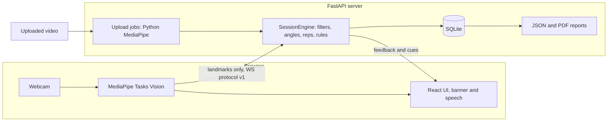

# RehabPose

A real-time, camera-only rehabilitation exercise coach that counts reps and gives form feedback for
upper-limb exercises, while the camera video stays in your browser.

<!-- Demo GIF: none recorded yet. Add docs/demo.gif here once a demo has been filmed with consent. -->
**Demo:** no GIF has been recorded yet.

> **Disclaimer:** RehabPose is a research and portfolio prototype. It is not a medical device, has not
> been clinically validated, and must not be used to diagnose, treat, or replace advice from a
> qualified healthcare professional. Stop exercising if you feel pain. Thresholds are engineering
> defaults, not clinical prescriptions.

## Status

**Works and tested:** the core engine, API, web app and ML pipeline, on macOS on Apple Silicon.

**Not yet checked:**
- **Accuracy on real people.** Every accuracy number below comes from generated data.
- **Real datasets.** None has been downloaded, so no model has trained on real data.
- **Temporal models in the app.** They are trained and exported, but live sessions use the rule
  engine only.
- **Docker, GitHub CI and Linux.** The files are written, but none of them has been run.
- **Phone use over HTTPS.** TLS was tested on the Mac only, not on a phone.
- **Live browser FPS.** NOT YET MEASURED.

Phase-by-phase status and open issues are in [PROGRESS.md](PROGRESS.md).

## Highlights

- **Private by design.** Pose estimation runs in the browser, and only landmarks reach the server. The
  production build's Content-Security-Policy also blocks MediaPipe's built-in telemetry
  ([ADR 0001](docs/adr/0001-landmarks-over-websocket.md), [ADR 0003](docs/adr/0003-csp-blocks-third-party-requests.md)).
- **Explainable engine.** One Euro smoothing, joint angles, a hysteresis rep state machine and YAML
  rules produce each cue, and each threshold is editable. See the
  [exercise spec](docs/04_exercise_spec.md).
- **Five exercises.** Shoulder flexion, shoulder abduction, elbow flexion, shoulder external rotation
  (experimental) and forward reach (optional).
- **Live and upload modes.** Both use the same engine. Upload mode also writes an annotated MP4, and
  each session gets a JSON and PDF report ([sample](reports/samples/sample_report.pdf)).
- **Progress tools.** Streaks, badges, per-user therapist targets, and data export and delete.
- **Honest ML pipeline.** Six model types, subject-wise cross-validation, held-out test subjects,
  MLflow tracking and ONNX export, with synthetic results labelled as such.

## Architecture



More detail is in [docs/03_architecture.md](docs/03_architecture.md).

## Quickstart (native)

You need an Apple Silicon Mac, [uv](https://docs.astral.sh/uv/) and Node 24 (see `.nvmrc`). uv installs
Python 3.12 for you.

**1. Install.**
```bash
git clone https://github.com/MfmRifath/RehabPos.git
cd RehabPos
uv sync
```

**2. Download the pose models.** They come from Google's MediaPipe storage and total about 44 MB.
```bash
uv run python -c "from pathlib import Path; from rehabpose.pose.model_files import download_model; [download_model(v, Path('data/models')) for v in ('lite', 'full', 'heavy')]"
```

**3. Build the web app and start the server.**
```bash
cd frontend
npm ci
npm run build
cd ..
uv run rehabpose serve
```
Then open http://127.0.0.1:8000 in Chrome.

### Development mode

Run these in two terminals from the repo root to get hot reload. The dev server has no
Content-Security-Policy, so MediaPipe's telemetry is blocked only in the production build.

Terminal 1:
```bash
uv run rehabpose serve
```
Terminal 2:
```bash
cd frontend
npm run dev
```
Then open http://localhost:5173.

### Analyze a video from the command line

Replace `my_video.mp4` with your file.
```bash
uv run rehabpose analyze my_video.mp4 --exercise shoulder_flexion --side R
```

## Quickstart (Docker)

**These files have never been built or run**, so expect to fix things. The image is CPU-only, and live
mode is unaffected because pose runs in the browser. Put the pose models in `data/models/` first (step 2
above). Details are in [docs/08_deployment_plan.md](docs/08_deployment_plan.md#2-docker-single-container-cpu-only).

```bash
docker compose build
docker compose up
```
Then open http://127.0.0.1:8000.

## Use a phone on the same network

Browsers allow camera access only on secure origins, so a phone needs HTTPS. These steps use
[mkcert](https://github.com/FiloSottile/mkcert). The server's TLS was tested on the Mac with a
self-signed certificate, but **the full phone flow has not been tested**.

> **The API has no login.** Anyone on your network who can reach this port can read and delete session
> data. Use this only on a network you trust, and stop the server afterwards.

**1. Create a certificate for your Mac's address.** `en0` is usually Wi-Fi. The certificate goes in
`data/`, which git ignores.
```bash
brew install mkcert
mkcert -install
LAN_IP=$(ipconfig getifaddr en0)
mkdir -p data/certs
mkcert -cert-file data/certs/lan.pem -key-file data/certs/lan-key.pem "$LAN_IP" localhost 127.0.0.1
```

**2. Build the web app if you haven't, then start the server** in the same terminal.
```bash
uv run rehabpose serve --host "$LAN_IP" --ssl-certfile data/certs/lan.pem --ssl-keyfile data/certs/lan-key.pem
```

**3. Trust the certificate on the phone.** Print the folder holding the root certificate, then send
`rootCA.pem` from it to the phone. Never share `rootCA-key.pem`.
```bash
mkcert -CAROOT
```
On iOS, install the profile, then turn on full trust under Settings → General → About → Certificate
Trust Settings. On Android, install it as a CA certificate under the security settings.

**4. Open the app on the phone.** Print the address, then open it there.
```bash
echo "https://$LAN_IP:8000"
```

## Results

**SYNTHETIC: these are not results about people.** All models were trained and tested on generated
skeletons, so these numbers show only that the pipeline works. They say nothing about accuracy on real
users, and the generator was also written for this project.

All values come from [reports/results_summary.json](reports/results_summary.json), built from the
evaluation reports at commit `b48c5a1`: 16 generated subjects, 3 of them held out for testing, with 5
folds and 3 seeds. The CI covers the test subjects for seed 0 only. With 3 test subjects it is coarse,
and it excludes seed variation, which is larger for some models.

| Config | MLflow run | CV macro-F1 | Test macro-F1 by seed | Seed 0 95 % CI | p95 ms CPU / MPS |
|---|---|---|---|---|---|
| `rep_bilstm` | `6db9b52e` | 0.813 ± 0.054 | 0.798, 0.890, 0.835 | 0.759 to 0.799 | 1.46 / 3.24 |
| `rep_lgbm` | `cb7fe7f1` | 0.987 ± 0.015 | 0.994, 1.000, 1.000 | 0.985 to 1.000 | 0.16 / n/a |
| `rep_lstm` | `52a69b83` | 0.789 ± 0.055 | 0.797, 0.805, 0.831 | 0.738 to 0.835 | 0.74 / 1.91 |
| `rep_stgcn` | `34d375a8` | 0.657 ± 0.095 | 0.620, 0.736, 0.675 | 0.545 to 0.667 | 0.81 / 1.04 |
| `rep_tcn` | `fb285e55` | 0.831 ± 0.063 | 0.840, 0.769, 0.924 | 0.798 to 0.851 | 0.57 / 0.54 |
| `rep_transformer` | `b92cc82f` | 0.886 ± 0.107 | 0.940, 0.608, 0.900 | 0.915 to 0.962 | 0.38 / 1.03 |
| `stream_lstm` | `7d065d76` | 0.713 ± 0.031 | 0.735, 0.743, 0.761 | 0.589 to 0.790 | 0.54 / 1.45 |
| `stream_stgcn` | `568c72df` | 0.435 ± 0.029 | 0.364, 0.409, 0.378 | 0.302 to 0.742 | 0.72 / 1.01 |
| `stream_tcn` | `5bde3f67` | 0.731 ± 0.022 | 0.756, 0.697, 0.734 | 0.577 to 0.824 | 0.56 / 0.56 |
| `stream_transformer` | `96a55efe` | 0.768 ± 0.011 | 0.769, 0.783, 0.789 | 0.657 to 0.929 | 0.35 / 1.23 |

`rep_*` models classify whole reps, and `stream_*` models flag compensation in sliding windows.
To regenerate one row, run `uv run rehabpose train --config configs/train/rep_lgbm.yaml`.

**Rule engine on the same synthetic test sets:**

| Measure | Value |
|---|---|
| Rep-count MAE | 0.0 |
| Rule labels macro-F1 / accuracy | 0.965 / 0.958 |
| Shoulder angle MAE / RMSE | 2.56° / 3.40° |
| Shoulder 95 % limits of agreement | -6.63° to 6.70° |
| Elbow angle MAE / RMSE | 2.47° / 3.25° |
| Elbow 95 % limits of agreement | -6.28° to 6.45° |

The generator injects errors that were designed around these same rules, so a high score here is expected
and is not evidence of good form assessment.

**Speed,** measured on one Apple M3 Pro with 18 GB of memory, on a rendered cartoon video. Pose ran on the
CPU in Python, not in the browser. Details are in [reports/benchmarks.md](reports/benchmarks.md).

| Pose model | Pose ms, median / p95 | End-to-end FPS | Peak MB |
|---|---|---|---|
| lite | 7.934 / 8.122 | 122.6 | 290.0 |
| full | 12.727 / 12.979 | 77.1 | 304.8 |
| heavy | 52.232 / 52.784 | 19.1 | 366.9 |

Server processing per WebSocket message is 0.168 ms median and 0.193 ms p95. The client round trip over
localhost is 0.299 ms median and 0.369 ms p95. Both used synthetic landmarks.

Accuracy on real people, targets on real data and live browser FPS: NOT YET MEASURED.

## Datasets and licences

**No public dataset has been downloaded or used.** Loaders exist, but their file layouts are assumed
until checked against real files. Using one requires `--i-accept-license`. Licences below were checked on
2026-11-01; confirm them on the dataset's page before use. Full details are in
[docs/05_data_plan.md](docs/05_data_plan.md#2-public-datasets).

| Dataset | Licence as checked | Note |
|---|---|---|
| UCO Physical Rehabilitation | Videos on request, terms set by the authors | Access by email to the authors |
| UCOPhyRehab++ | CC BY 4.0 (Zenodo record) | Adds derived modalities and therapist scores |
| REHAB24-6 | CC BY-NC 4.0 | **Non-commercial research only** |
| Upper-limb stroke video dataset | CC BY 4.0 | Recorded with volunteers |
| IntelliRehabDS | CC BY 4.0 | |
| UI-PRMD | ODC PDDL 1.0, not confirmed on the source page | The page refused automated access when checked |
| KIMORE | Not confirmed | The page was unreachable when checked |
| Toronto Rehab Stroke Pose | Not confirmed | The Kaggle page needs a sign-in or browser to read its terms |

The MediaPipe library and tasks-vision package are Apache-2.0. The licence of the `.task` model files
was not confirmed from a primary source, so check Google's model card before redistributing them. They
are not committed to this repository.

## Ethics

Consent, privacy, safety design and known risks are in
[docs/09_ethics_privacy.md](docs/09_ethics_privacy.md). Limits of the models are in the
[model card](docs/10_model_card.md), and the plan for the project's own recordings is in the
[datasheet](docs/11_datasheet.md). No own recordings have been collected.

## Roadmap

1. Record consented healthy-volunteer data, then measure angle, rep and form accuracy on it.
2. Check the dataset loaders against real files, once each licence is accepted.
3. Decide from real data whether to keep the One Euro defaults, which increased angle error on synthetic
   data.
4. Enable a temporal model in live sessions, but only if it beats the rule engine on real data.
5. Add per-code thresholds for streaming compensation flags.
6. Build and run Docker and CI, and test the phone flow.
7. Optional: Core ML export and an iOS prototype.

## Contributing

See [CONTRIBUTING.md](CONTRIBUTING.md).

## Citations

**Pose estimation and smoothing**
- Lugaresi et al. "MediaPipe: A Framework for Building Perception Pipelines." [arXiv:1906.08172](https://arxiv.org/abs/1906.08172), 2019.
- Bazarevsky et al. "BlazePose: On-device Real-time Body Pose tracking." [arXiv:2006.10204](https://arxiv.org/abs/2006.10204), 2020.
- Casiez, Roussel, Vogel. "1 € Filter: A Simple Speed-based Low-pass Filter for Noisy Input in Interactive Systems." CHI 2012, pp. 2527–2530. [doi:10.1145/2207676.2208639](https://doi.org/10.1145/2207676.2208639). Used for smoothing.

**Related methods**
- Ullah et al. "A real time action scoring system for movement analysis and feedback in physical therapy using human pose estimation." *Scientific Reports* 15:44784, 2025. [doi:10.1038/s41598-025-29062-7](https://doi.org/10.1038/s41598-025-29062-7). Scores with DTW and normalized cross-correlation. RehabPose uses DTW only.
- Mesquita, Cóias, Dubrawski, Bernardino. "Frame-Level Real-Time Assessment of Stroke Rehabilitation Exercises from Video-Level Labeled Data: Task-Specific vs. Foundation Models." [arXiv:2506.03752](https://arxiv.org/abs/2506.03752), 2025. Related to the streaming compensation task.

**Datasets (none used yet)**
- Aguilar-Ortega et al. "UCO Physical Rehabilitation: New Dataset and Study of Human Pose Estimation Methods on Physical Rehabilitation Exercises." *Sensors* 23(21):8862, 2023. [doi:10.3390/s23218862](https://doi.org/10.3390/s23218862).
- Aguilar-Ortega, Zafra-Palma, Muñoz-Salinas, Marín-Jiménez. "UCOPhyRehab++: A multi-modal and multi-view dataset for human rehabilitation analysis." *Scientific Data* 13:1035, 2026. [doi:10.1038/s41597-026-07362-5](https://doi.org/10.1038/s41597-026-07362-5). Data: [Zenodo](https://doi.org/10.5281/zenodo.17935737).
- Černek, Sedmidubský, Budíková. "REHAB24-6: Physical Therapy Dataset for Analyzing Pose Estimation Methods." SISAP 2024, pp. 18–33. [doi:10.1007/978-3-031-75823-2_2](https://doi.org/10.1007/978-3-031-75823-2_2). Data: [Zenodo](https://doi.org/10.5281/zenodo.13305826).
- Nandana, Dharshini, Viswanathan, Nair. "An upper limb stroke rehabilitation exercise video dataset." *Data in Brief* 66:112819, 2026. [doi:10.1016/j.dib.2026.112819](https://doi.org/10.1016/j.dib.2026.112819). Data: [Mendeley](https://doi.org/10.17632/49h9dcwx5v.1).
- Miron, Sadawi, Ismail, Hussain, Grosan. "IntelliRehabDS (IRDS)—A Dataset of Physical Rehabilitation Movements." *Data* 6(5):46, 2021. [doi:10.3390/data6050046](https://doi.org/10.3390/data6050046). Data: [Zenodo](https://doi.org/10.5281/zenodo.4610859).
- Vakanski, Jun, Paul, Baker. "A Data Set of Human Body Movements for Physical Rehabilitation Exercises." *Data* 3(1):2, 2018. [doi:10.3390/data3010002](https://doi.org/10.3390/data3010002).
- Capecci et al. "The KIMORE Dataset: KInematic Assessment of MOvement and Clinical Scores for Remote Monitoring of Physical REhabilitation." *IEEE TNSRE* 27(7):1436–1448, 2019. [doi:10.1109/TNSRE.2019.2923060](https://doi.org/10.1109/TNSRE.2019.2923060).
- Dolatabadi et al. "The Toronto Rehab Stroke Pose Dataset to Detect Compensation during Stroke Rehabilitation Therapy." PervasiveHealth 2017, pp. 375–381. [doi:10.1145/3154862.3154925](https://doi.org/10.1145/3154862.3154925).

## License

[Apache-2.0](LICENSE). The optional `[ablation]` extra installs Ultralytics (AGPL-3.0), which the core
package never imports.
