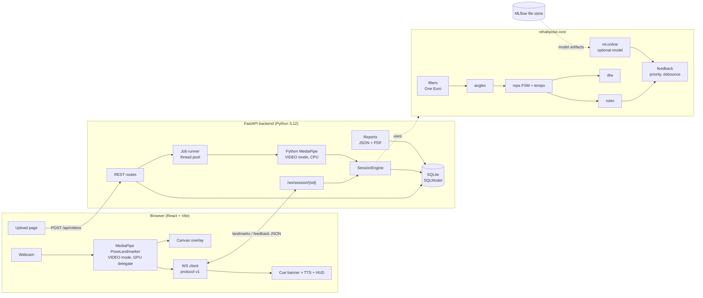
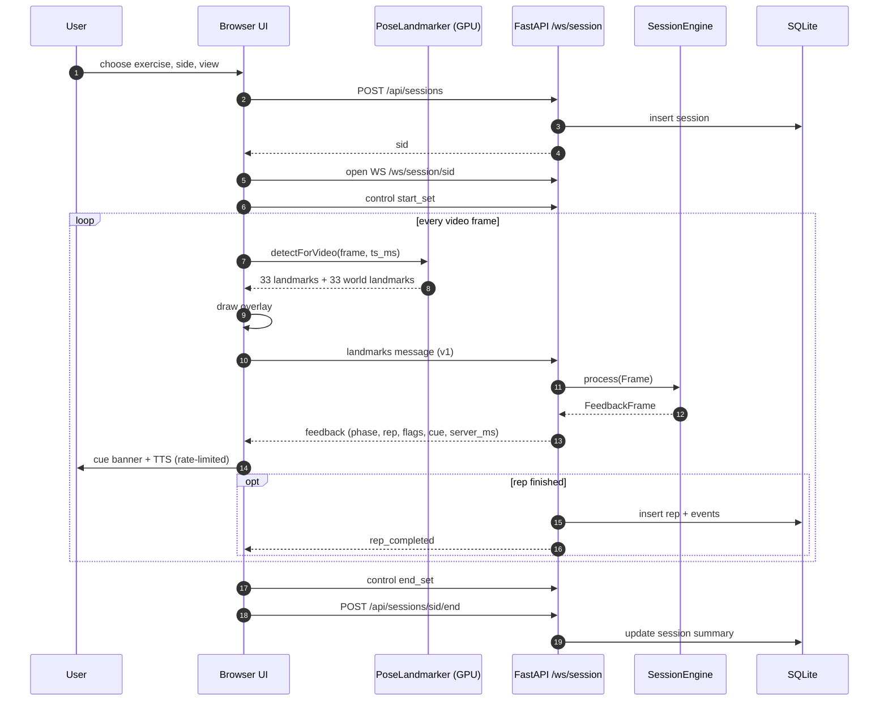
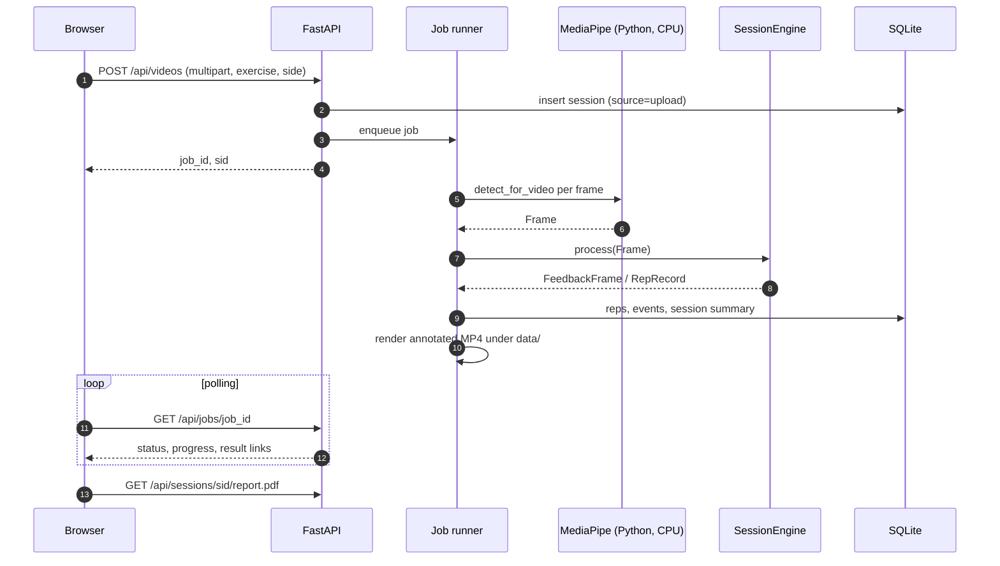
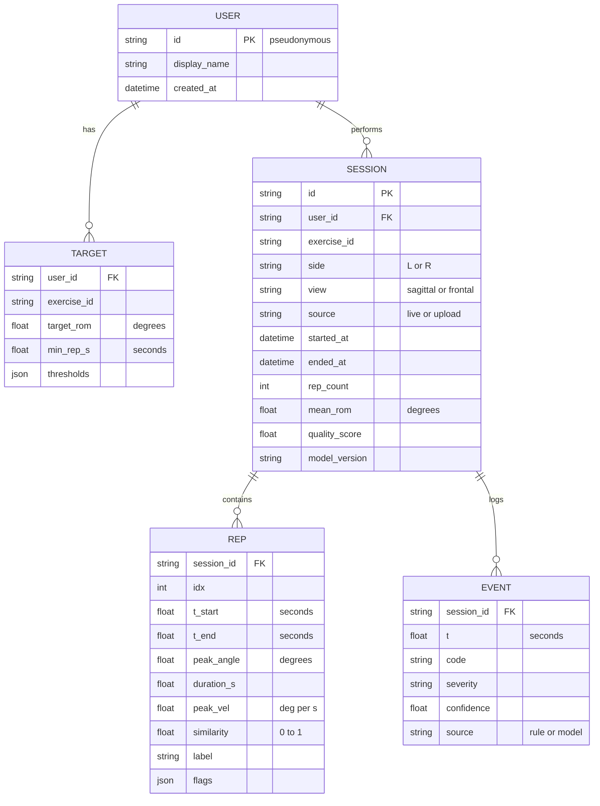

# 03 — Architecture

The architecture below is decided. Changes require an ADR in [adr/](adr/0001-landmarks-over-websocket.md).
Requirements are referenced as FR-xx / NFR-xx from [02_srs.md](02_srs.md).

## 1. Context
Two input paths share one deterministic core engine.

- **Live mode:** the browser runs pose estimation and sends only landmarks to the backend
  ([ADR 0001](adr/0001-landmarks-over-websocket.md)).
- **Upload mode:** the backend runs Python MediaPipe on an uploaded video in a background job.

## 2. Component diagram


### Module map
| Package | Responsibility |
|---|---|
| `rehabpose.core` | Pure geometry and state machines: `landmarks`, `filters`, `angles`, `reps`, `tempo`, `dtw`, `rules`, `features`, `feedback`, `engine` |
| `rehabpose.pose` | Pose backends behind the `PoseEstimator` protocol: MediaPipe (default), RTMPose (`[rtm]`), YOLO (`[ablation]`, lazy import), and model-file resolution |
| `rehabpose.data` | Video I/O, landmark extraction, joint maps, splits, annotation schema, dataset loaders, labeling tool |
| `rehabpose.ml` | Transforms, datasets, models (LGBM, TCN, LSTM, Transformer, ST-GCN), train/evaluate/export, online inference |
| `rehabpose.api` | FastAPI app, WebSocket, REST routes, DB models, jobs, reports |
| `rehabpose.bench` | Pose/engine/server benchmarks |
| `frontend/` | React UI, browser pose, WS client, TTS, charts |

## 3. Live-mode sequence


Backpressure (NFR-10): the server keeps only the most recent unprocessed landmark message per
connection. If processing falls behind, older messages are dropped and counted. Feedback always refers
to the frame number it was computed from.

## 4. Upload-mode sequence


## 5. Data model (ER)

`TARGET` has the composite key (`user_id`, `exercise_id`). `REP` has (`session_id`, `idx`). Deleting
a user cascades to targets, sessions, reps and events (FR-35).

## 6. REST API
All paths are prefixed with `/api` unless noted. JSON bodies are validated by pydantic models in
`rehabpose.api.schemas`.

| Method | Path | Purpose |
|---|---|---|
| GET | `/api/health` | Liveness, version, pose model, torch device |
| GET | `/api/exercises` | List exercise configs (id, name, view, target, rules) |
| GET | `/api/users/{uid}/targets` | Per-exercise targets and thresholds |
| PUT | `/api/users/{uid}/targets` | Update targets (therapist settings) |
| POST | `/api/sessions` | Create session `{user_id, exercise_id, side, view, source}` → `sid` |
| GET | `/api/sessions/{sid}` | Session with reps and events |
| POST | `/api/sessions/{sid}/end` | Close session, compute summary |
| GET | `/api/sessions/{sid}/report.json` | Structured report |
| GET | `/api/sessions/{sid}/report.pdf` | PDF report (with disclaimer) |
| GET | `/api/users/{uid}/progress` | Aggregations: ROM trend, reps, quality, streaks, badges |
| POST | `/api/videos` | Upload video (multipart) → `job_id`, `sid` |
| GET | `/api/jobs/{job_id}` | Job status / progress / result links |
| WS | `/ws/session/{sid}` | Live landmarks → feedback (protocol v1) |
| GET | `/api/sessions/{sid}/annotated.mp4` | Annotated video of an upload session (after its job is done) |
| WS | `/ws/frames/{sid}` | Optional: JPEG frames for server-side pose ablations |

Phase 8 adds `GET /api/users/{uid}/export` and `DELETE /api/users/{uid}` (FR-35).
Status codes: 201 for session creation and 202 for an accepted upload. 404 means an unknown
session, user, exercise or job. 415 is a non-video upload, 413 an upload over `max_upload_mb`
(500 by default), and 422 a validation error (for example a view the exercise doesn't allow, or a
threshold override for an unknown rule). `/ws/frames/{sid}` is not implemented yet; it is planned
for the phase 7 pose-backend ablations.

**Upload jobs** run one at a time in a thread pool, using Python MediaPipe on the CPU. They live
in memory and do not survive a restart. The **raw uploaded video is deleted when its job
finishes**, whether it succeeds or fails (docs/09 §4). Landmarks, the annotated video and the CSV/JSON
outputs are kept under `data/sessions/<sid>/` until the session is deleted (phase 8).

## 7. WebSocket protocol v1
These are pydantic models in `rehabpose/api/schemas.py`, mirrored as TypeScript types in
`frontend/src/ws/protocol.ts`. Every message carries `"v": 1` and a `"type"`. Unknown versions or
types get an `error` reply, and the connection stays open.

### Client → server
```json
{"v": 1, "type": "landmarks", "sid": "s_abc", "frame": 120, "ts_ms": 4000,
 "img": {"w": 1280, "h": 720},
 "lm":    [[0.51, 0.22, -0.31, 0.99], "... 33 x [x, y, z, visibility]"],
 "world": [[0.01, -0.62, -0.12, 0.99], "... 33 x [x, y, z, visibility] (metres, hip-centred)"],
 "client_infer_ms": 14.2}
```
```json
{"v": 1, "type": "control", "action": "start_set"}
```
`action` ∈ `start_set | pause | end_set | calibrate`.

### Server → client
```json
{"v": 1, "type": "feedback", "frame": 120, "ts_ms": 4000,
 "angles": {"upper_arm_trunk": 92.4, "elbow_interior": 171.0, "trunk_tilt": 2.1},
 "phase": "ascending",
 "rep": {"count": 3, "last_peak": 148.0, "last_duration_s": 3.1, "last_similarity": 0.82},
 "flags": [{"code": "TRUNK_LEAN", "severity": "warn", "confidence": 0.9, "source": "rule"}],
 "cue": {"code": "TRUNK_LEAN", "text": "Keep your trunk upright", "speak": true},
 "quality": {"visibility_ok": true, "view_ok": true},
 "server_ms": 1.3}
```
The values in these examples are illustrative, not measurements.

Implementation notes (phase 5):
- Two **optional fields** are added to v1, and clients may ignore them: `cue.severity`
  (`info` / `warn` / `error`, for the banner colour) and `feedback.dropped` (frames skipped by
  backpressure so far).
- **Backpressure:** an unprocessed landmarks message is replaced by the newer one and counted
  as dropped. The newest frame is always answered. Control messages are never dropped: a pending
  frame is processed before the control is applied.
- **Error codes:** `bad_message` (fails pydantic validation, including a wrong `v`), `sid_mismatch`,
  `non_monotonic_ts`, and `unknown_session` / `session_ended`. The last two close the socket with
  code 4404. All other errors keep the connection open.
- **Times:** rep and event times stored in the DB are seconds since the session's first frame.
- **Per-user targets** (therapist overrides) apply when the WS connects and when an upload job
  starts. `phase` ∈ `rest | ascending |
peak | descending`. An angle whose landmarks fail the visibility gate is `null`. `cue` is `null` when
nothing should be shown.

| type | When | Payload |
|---|---|---|
| `feedback` | every processed landmark message | as above |
| `rep_completed` | a rep passes validation | full rep record ([04 §8](04_exercise_spec.md#8-rep-record-and-labels)) |
| `setup_status` | during calibration / setup | `{calibrated, visibility_ok, view_ok, hints[]}` |
| `error` | invalid message, unknown session | `{code, message}` |

## 8. Deployment topology
- **Native dev:** `uv run rehabpose serve` on `127.0.0.1:8000` plus `npm run dev` (Vite on `:5173`,
  CORS allowed).
- **Single container:** a multi-stage Docker image builds `frontend/dist`. FastAPI serves it as static
  files. The `data/` volume holds the DB, models and uploads.
- **Phone:** HTTPS is required for camera access. Use mkcert with the LAN IP. See
  [08_deployment_plan.md](08_deployment_plan.md).

## 9. Cross-cutting concerns
- **Config:** `configs/app.yaml` (+ `REHABPOSE_*` env) and `configs/exercises/*.yaml`, validated by
  pydantic models.
- **Logging:** the standard `logging` module, with a rich handler in the CLI. No print statements in
  library code.
- **Time base:** all engine timing uses `ts_ms` from the source (browser `performance.now()` or video
  timestamps), not server wall-clock time.
- **Versioning:** each session stores `model_version` (pose model variant + optional temporal model run id).
