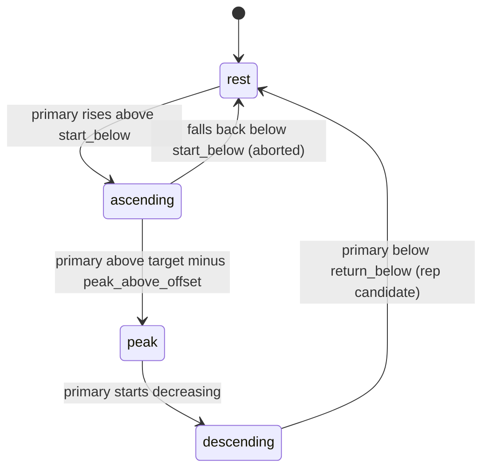

# 04 — Exercise and biomechanics specification

Every threshold here is a **default** stored in `configs/exercises/<id>.yaml`. A therapist can override
it per user (FR-33). These are engineering defaults, **not clinical prescriptions**. Angles are in
degrees, times in seconds, and distances in normalized units (shoulder widths) unless noted.

## 1. Landmark schema
MediaPipe Pose Landmarker returns 33 landmarks per person:

- `lm[33, 4]`: (x, y, z, visibility). x and y are normalized to the image ([0, 1]). z is relative depth
  (same scale as x, origin at the hips).
- `world[33, 4]`: (x, y, z, visibility) in metres, hip-centred.

| Index | Joint | Index | Joint |
|---|---|---|---|
| 0 | nose | 7 / 8 | left / right ear |
| 11 / 12 | left / right shoulder | 13 / 14 | left / right elbow |
| 15 / 16 | left / right wrist | 23 / 24 | left / right hip |

Side selection: `L` uses the odd indices (7, 11, 13, 15, 23) and `R` uses the even indices (8, 12, 14,
16, 24). "Left" is the subject's anatomical left, as MediaPipe defines it.

**2D angles use pixel-scaled coordinates** `(x·w, y·h)`, so that non-square frames do not distort
angles. **3D angles** use `world`.

Derived points: `mid_shoulder = (lm11 + lm12)/2`, `mid_hip = (lm23 + lm24)/2`.

## 2. Quality gates and calibration
- **Visibility gate:** if any landmark required by a measure has visibility < **0.6**, that measure is
  `unknown` (`null` in the WS payload). Rules depending on it do not fire, so no corrective cue is
  given. A setup cue is given instead if the condition persists.
- **View check:** the frontal/sagittal heuristic uses the 2D shoulder-width/torso-length ratio:
  ≥ 0.45 is frontal, ≤ 0.25 is sagittal, and anything in between is ambiguous (accepted). A mismatch
  with the session view that lasts ≥ 1.0 s sets `quality.view_ok = false` and raises the setup cue
  `SETUP_VIEW_<VIEW>`. Rules list the views in which they are `unknown` (`unknown_in_views`).
- **Calibration:** during the first **1.0 s** of a set, the user is at rest. The engine averages:
  - `baseline_trunk_tilt` (deg)
  - `baseline_ear_shoulder` (vertical ear–shoulder distance on the exercising side, px)
  - `baseline_shoulder_width` (px, distance between landmarks 11 and 12)

  If visibility fails during calibration, the engine extends the window, up to 3 s, then reports
  `setup_status` with hints.
- **Normalization unit:** shoulder width, the distance between landmarks 11 and 12. It is used for all
  distance thresholds and for One Euro speed normalization. In side-on (sagittal) 2D views the
  shoulders overlap and the projected width collapses towards 0, so the implementation
  (`rehabpose.core.angles.body_scale`) floors it at 0.7 × torso length (mid-hip to mid-shoulder).
  0.7 is roughly the adult shoulder-width to torso-length ratio. In frontal views the floor is
  normally inactive.

## 3. Measures
Notation: `S`, `E`, `W`, `H`, `Ear` = shoulder, elbow, wrist, hip, ear on the exercising side.
`angle(u, v)` is the unsigned angle between vectors u and v, in [0°, 180°].

| Measure | Definition | Range / meaning |
|---|---|---|
| `upper_arm_trunk_angle` | `angle(E − S, H − S)` | 0 = arm at side, 180 = overhead |
| `elbow_interior` | `angle(S − E, W − E)` | 180 = straight arm |
| `elbow_flexion` | `180 − elbow_interior` | 0 = straight, larger = more flexed |
| `trunk_tilt` | `angle(mid_shoulder − mid_hip, up)` with `up = (0, −1)` in image coords | 0 = upright |
| `trunk_tilt` side-on | `angle(S − H, up)` on the exercising side, used in the sagittal view when that shoulder and hip are visible | a side-on camera usually cannot see the far shoulder and hip |
| `hike_ratio` | `(S_y − Ear_y) / shoulder_width`, compared to baseline | drops when the shoulder hikes toward the ear |
| `shoulder_width_ratio` | `shoulder_width / baseline_shoulder_width` | < 1 when the trunk rotates (frontal view) |
| `forearm_rotation` (exp.) | angle of `W − E` about the upper-arm axis, from `world` | external rotation (ER exercise) |
| `reach_ratio` (opt.) | forward displacement of `W` from its rest position / arm length (`norm(S−E) + norm(E−W)`) | forward reach |

For shoulder abduction, `upper_arm_trunk_angle` is computed from 2D image coordinates in a frontal
view, which is a projection onto the frontal plane. For flexion it is computed in a sagittal view, a
projection onto the sagittal plane. Phase 7 ablations compare 2D against 3D (world) angles.

## 4. Rep detection (hysteresis FSM)


A rep candidate becomes a rep only if:
- duration (t_end − t_start) ≥ **0.8 s** (global minimum), and
- peak ≥ `start_below + 20°`.

Partial reps, where the angle rises but never reaches the peak threshold, are recorded as
`incomplete_rom` if the peak ≥ `start_below + min_excursion` (20° by default). Otherwise they are
ignored. The FSM runs on the **smoothed** primary angle. Implementation details
(`rehabpose.core.reps`):

- **Arming:** at the start of a set and after a reset, a rep can only begin once the primary has
  been seen at or below `start_below`. A rep observed only from its middle is never counted. A rep
  that finishes normally re-arms immediately, so resting slightly above `start_below` between reps
  still works.
- **Start re-anchoring:** while ascending, the start moves to the lowest point seen. Pauses near
  rest therefore don't inflate the rep duration.
- **Peak hysteresis:** the peak ends when the value drops `peak_drop` (5° by default) below the
  running maximum. A dip that rises again by more than `peak_drop`, without falling below
  `return_below`, resumes the same rep instead of splitting it.
- **Unknown frames** hold the state. If more than 0.5 s is unknown, the FSM resets to `rest`.

Each exercise YAML defines `fsm: {start_below, peak_above_offset, return_below}`. Flexion uses the
spec's defaults (start < 30, peak > target − 15, return < 40). The other exercises use the same values
until phase 3 tunes them on synthetic data; those values are marked *provisional* in the YAML.

## 5. Exercises

### 5.1 `shoulder_flexion`
| Field | Default |
|---|---|
| view | sagittal |
| primary | `upper_arm_trunk_angle` |
| target | 150° |
| fsm | start_below 30, peak_above_offset 15, return_below 40 |
| min_rep_s | 2.0 |
| max_peak_vel_dps | 90 |

| Rule | Condition | Notes |
|---|---|---|
| ELBOW_BEND | `elbow_interior < 160` for > 0.3 s | |
| TRUNK_LEAN | `abs(trunk_tilt − baseline) > 10` | |
| INCOMPLETE_ROM | rep peak < 0.9 × target | evaluated at rep end |
| TOO_FAST | duration < 2.0 s **or** peak velocity > 90 °/s | evaluated at rep end |
| SHOULDER_HIKE | — | always `unknown` in sagittal view |

### 5.2 `shoulder_abduction`
| Field | Default |
|---|---|
| view | frontal |
| primary | `upper_arm_trunk_angle` (frontal projection) |
| target | 130° |
| fsm | start_below 30, peak_above_offset 15, return_below 40 (provisional) |
| min_rep_s | 2.0 |
| max_peak_vel_dps | 90 |

| Rule | Condition | Notes |
|---|---|---|
| TRUNK_LEAN | `abs(trunk_tilt − baseline) > 8` | lateral lean |
| SHOULDER_HIKE | `hike_ratio` drop > 15 % vs baseline | |
| ELBOW_BEND | `elbow_interior < 160` for > 0.3 s | |
| PLANE_DRIFT | world `abs(W_z − S_z) > 0.15 m` | experimental; monocular depth is unreliable |
| INCOMPLETE_ROM | peak < 0.9 × target | |
| TOO_FAST | duration < 2.0 s or peak velocity > 90 °/s | |

### 5.3 `elbow_flexion`
| Field | Default |
|---|---|
| view | sagittal (frontal allowed with a setup warning) |
| primary | `elbow_flexion` |
| target | 130° |
| fsm | start_below 30, peak_above_offset 15, return_below 40 (provisional) |
| min_rep_s | 1.5 |
| max_peak_vel_dps | 90 |

| Rule | Condition |
|---|---|
| SHOULDER_DRIFT | `upper_arm_trunk_angle > 20` (upper arm should stay at the side) |
| TRUNK_LEAN | `abs(trunk_tilt − baseline) > 10` |
| INCOMPLETE_ROM | peak < 0.9 × target |
| TOO_FAST | duration < 1.5 s or peak velocity > 90 °/s |

### 5.4 `shoulder_external_rotation` (experimental)
| Field | Default |
|---|---|
| view | frontal |
| primary | `forearm_rotation` (world landmarks) |
| target | set in YAML, provisional until validated |

| Rule | Condition |
|---|---|
| ELBOW_AWAY | `abs(E_x − H_x) > 0.25 × shoulder_width` (elbow should stay tucked at the side) |
| TRUNK_ROTATION | `shoulder_width_ratio < 0.85` (shrink > 15 %) |

Monocular estimates of forearm rotation are known to be weak. The exercise is labelled experimental in
the UI, and its measures are excluded from accuracy targets until they are validated.

### 5.5 `forward_reach` (optional)
| Field | Default |
|---|---|
| view | sagittal |
| primary | `reach_ratio` (FSM thresholds in ratio units, provisional) |

| Rule | Condition |
|---|---|
| TRUNK_LEAN | `abs(trunk_tilt − baseline) > 15` |
| SHOULDER_HIKE | as in abduction; `unknown` in sagittal view |
| TRUNK_ROTATION | as in external rotation; needs frontal cues, so `unknown` in pure sagittal view |

## 6. Rules, cues and priority
- **Severity:** `info` (setup hints), `warn` (compensation), `error` (unsafe or invalid setup).
- **Confidence:** for rules, this is the minimum visibility of the involved landmarks, scaled to
  [0, 1]. For the model, it is the predicted probability.
- **Unknown handling:** a rule whose inputs are `unknown` or view-dependent in the wrong view yields
  no flag and no cue. Baseline rules (`abs_delta_gt`, `drop_frac_gt`) stay unknown until
  calibration is done.
- **Experimental rules** (`experimental: true`, currently PLANE_DRIFT) are **off by default**
  (`EngineConfig.experimental_rules`). With real MediaPipe on a synthetic test video, world depth
  raised PLANE_DRIFT at every peak of correct reps (2026-11-01, phase 3).
- **Setup cues:** `SETUP_VISIBILITY` (primary landmarks invisible for ≥ 0.5 s, severity error),
  `SETUP_VIEW_SAGITTAL` / `SETUP_VIEW_FRONTAL` (view mismatch ≥ 1.0 s), `CALIBRATING` (first
  second of a set).
- **Rep-level flags** (INCOMPLETE_ROM, TOO_FAST) are raised at rep end and stay active for 2.0 s,
  so they can pass the cue debounce.
- **Priority** (highest first): visibility/setup > `TRUNK_*` > `SHOULDER_HIKE` > `ELBOW_*` (incl.
  `SHOULDER_DRIFT`) > `TOO_FAST` > `INCOMPLETE_ROM`. `PLANE_DRIFT` ranks with `SHOULDER_*`.
- **Display:** at most one cue at a time.
- **Debounce:** a cue's condition must persist **≥ 0.5 s** before it fires.
- **TTS rate limit:** at most **1 spoken cue per 3 s**. Captions follow the same cue.
- **Cue texts:** each YAML contains `cue_texts: {CODE: "short imperative"}`, e.g.
  `TRUNK_LEAN: "Keep your trunk upright"`.

## 7. Tempo
- Angular velocity uses causal finite differences on the smoothed primary angle (°/s).
- About **45 °/s** is considered a controlled tempo. This reference comes from the UCOPhyRehab++
  scoring rubric (see [05_data_plan.md](05_data_plan.md)). It is a reference only, not a threshold.
- `TOO_FAST` defaults: duration below `min_rep_s` or peak velocity above `max_peak_vel_dps` (90 °/s).

## 8. Rep record and labels
| Field | Unit | Description |
|---|---|---|
| idx | — | 0-based rep index in the set |
| t_start, t_peak, t_end | s | from frame timestamps |
| peak_angle | deg | max of the smoothed primary measure |
| duration_s | s | t_end − t_start |
| peak_vel_dps | °/s | max abs angular velocity during the rep |
| flags | list | codes raised during the rep (debounced) |
| label | enum | `correct` \| `incomplete_rom` \| `too_fast` \| `compensated` |
| dtw_similarity | 0–1 | similarity to the exercise reference rep |

Label assignment (implemented in `rehabpose.core.rules.label_rep`): `compensated` if any `TRUNK_*`,
`SHOULDER_*`, `ELBOW_*` or `PLANE_*` flag was raised during the rep. Otherwise `too_fast` if
TOO_FAST. Otherwise `incomplete_rom` if INCOMPLETE_ROM. Otherwise `correct`. This mirrors the cue
priority.

## 9. DTW similarity
1. Take the rep's smoothed primary-angle curve and z-normalize it (zero mean, unit variance).
2. Take the exercise reference rep curve from YAML (`reference.curve`) and z-normalize it the same way.
3. Resample both curves to 64 samples, then compute DTW (|a−b| cost) with a Sakoe–Chiba band of
   10 % of the longer length. Normalize the distance by the warping path length.
4. `similarity = 1 / (1 + normalized_distance)`.

Until real reference reps are recorded, the reference curves are **synthetic** (generated
minimum-jerk profiles), and every YAML says so (`reference.source: synthetic`).

## 10. Exercise YAML schema
The schema is defined by the pydantic models in `rehabpose.core.exercise` (extra keys are
rejected). The shipped files are in `configs/exercises/`. Example (shoulder flexion, abridged):
```yaml
id: shoulder_flexion            # must equal the file name
name: Shoulder flexion
view: sagittal                  # sagittal | frontal; allowed_views: [...] for alternatives
primary_angle: upper_arm_trunk_angle
unit: deg                       # deg | ratio
target: 150
fsm: {start_below: 30, peak_above_offset: 15, return_below: 40}   # + min_excursion, peak_drop
min_rep_s: 2.0
max_peak_vel_dps: 90
rom_fraction: 0.9               # INCOMPLETE_ROM if peak < rom_fraction * target
rules:
  - {kind: frame, code: ELBOW_BEND, measure: elbow_interior, op: lt, value: 160, min_duration_s: 0.3}
  - {kind: frame, code: TRUNK_LEAN, measure: trunk_tilt, op: abs_delta_gt, value: 10}
  - {kind: frame, code: SHOULDER_HIKE, measure: hike_ratio, op: drop_frac_gt, value: 0.15,
     unknown_in_views: [sagittal]}
  - {kind: rep, code: INCOMPLETE_ROM, severity: info}
  - {kind: rep, code: TOO_FAST}
cue_texts: {ELBOW_BEND: "Keep your elbow straight", ...}   # required for every rule code
reference: {source: synthetic, n: 64}   # or {source: recorded, curve: [...]}
```
Frame-rule ops are `lt`, `gt`, `abs_delta_gt` (|value − baseline| > v) and `drop_frac_gt`
(1 − value/baseline > v). Extra measures for rules are `plane_drift_m` (world |W_z − S_z|),
`elbow_away` (|E_x − H_x| / body scale) and `shoulder_width`.

## 11. Known limitations
- Monocular 2D angles depend on the view. Out-of-plane motion foreshortens angles.
- World `z` (depth) from a single camera is noisy, so depth-based rules are experimental.
- Loose clothing, low light, occlusion by furniture and wheelchairs degrade landmarks. The visibility
  gate mitigates this but cannot fully detect it.
- The defaults have not been validated on patients. See [09_ethics_privacy.md](09_ethics_privacy.md).
